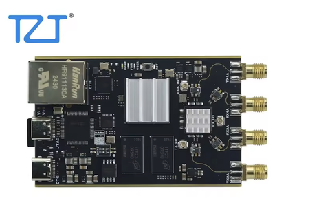

# fishball7010-open-fw

Open firmware for the cheap "TZT Pluto 7010 / 70 MHz-6 GHz" SDR clones (Zynq XC7Z010-CLG400 + AD9363, 2R2T, 1 GB RAM, gigabit Ethernet,
SD slot). The seller of the board this was developed on would not supply the GPL source for the shipped firmware, so this project rebuilds
a working open stack and goes further: it runs the [Tezuka](https://github.com/F5OEO/tezuka_fw) firmware with
[Maia SDR](https://maia-sdr.org) from the SD card, and replaces Tezuka's signal classifier with a new, much cheaper emitter detector.

The board turned out to be a **Fishball 7010** clone (its FSBL MIO/DDR setup matches Tezuka's `fishball7010` target on all 46 MIO registers).



*The board this was developed on, as sold by TZT (product photo from the AliExpress listing; image remains the seller's).*

## Why this exists

The manufacturer of this board did not release the source code for its firmware, although it ships GPL software (Linux, U-Boot, Buildroot).
So the shipped firmware was analysed instead: the boot files were extracted from the vendor SD card, the U-Boot and device tree were matched
byte-for-byte against public sources, and the board was identified as a Fishball 7010 clone. With that, an open stack could be rebuilt and
the newer [Tezuka](https://github.com/F5OEO/tezuka_fw) features (Maia SDR spectrum/waterfall web UI, Dashboard, MQTT status) were brought
to the board, together with CPU fixes and a new signal classifier. Only the vendor FPGA bitstream and FSBL remain closed binaries; they are reused
unchanged and replaced where possible by Maia's open bitstream.

## Changes from upstream Tezuka

Kernel, Maia SDR (maia-httpd, web UI, bitstream), Buildroot rootfs and the Dashboard are stock Tezuka v0.3.23 (Linux 6.12, fishball7010 target).
What differs:

- **Boot set for this board.** The vendor `BOOT.bin` is kept (its FSBL has this board's DDR/MIO setup). The kernel and Maia bitstream are packed in
  one FIT `uImage` (uncompressed kernel, because the vendor U-Boot has no LZMA; FPGA loaded via `fpga@1`). The kernel command line, including
  `uio_pdrv_genirq.of_id=uio_pdrv_genirq` and `maxcpus=2`, is set in the device tree's `/chosen`, since the vendor U-Boot ignores `setenv bootargs`.
- **Hardware labels.** The device-tree model/labels say AD9363 / Zynq-7010 (the driver itself cannot tell AD936x parts apart).
- **Signal classifier replaced.** Tezuka's template-matching classifier pinned one core. First rewritten as a fast equivalent
  (`classifier-fast/`: prefix-sum matching with NEON, persistent MQTT pipe, no libwebsockets), then replaced by classifier v2 (`classifier/`),
  a template-free emitter detector. The `state/classifier/*` topics the Dashboard reads are kept; `emitters`, `emitter_count`, `noise_floor_db`,
  `center_hz` and `sample_rate_hz` are new. The Dashboard does not display the emitter list yet.
- **CPU tuning of the status scripts** (`patches/`). `api_controller.sh` publishes only changed values (full refresh every 16 s), uses fork-free
  sysfs/proc reads and cached `fw_printenv`, and computes slow-changing values less often; `watchconsoletx.sh` and `update.sh` no longer fork every
  second. All 96 original topics are still published; `state/main/forks_per_s` is new.
- **Result:** CPU metric 97 (stock classifier on) / 48-56 (classifier off) down to 11-17, and about 4 forks/s down from ~130 per status cycle.

## What is in here

| Path | What |
|---|---|
| `classifier/` | **Classifier v2**: emitter detector/classifier (C, static ARM binary) with its Python reference spec, captures and tests |
| `classifier-fast/` | Earlier optimised version of Tezuka's template classifier (kept for reference/comparison) |
| `patches/` | CPU-tuning patches for Tezuka's `api_controller.sh`, `watchconsoletx.sh`, `update.sh` plus the test scripts used to measure them |
| `scripts/` | Boot-set assembly: FIT image, device-tree bootargs, ramdisk overlay, SD card writer |
| `docs/BUILD.md` | Step-by-step build instructions |
| `docs/NOTES.md` | Full project log: findings, pitfalls, measurements |
| `reference/` | Decompiled vendor device tree |
| `results/` | RF test plots (869 MHz capture, TX tone test, 800-900 MHz sweep) |

Not included (and never committed): the vendor `BOOT.bin` (FSBL, U-Boot, vendor bitstream), Tezuka release binaries, kernel/ramdisk images,
card images. You supply the `BOOT.bin` from your own card; everything else is built or downloaded as described in `docs/BUILD.md`.

## Status

- Boots from SD; Maia SDR web UI and Tezuka Dashboard work (https://192.168.2.1); labels corrected to AD9363 / Zynq-7010.
- RX-A verified 800-900 MHz and 2.4 GHz, TX1-A verified at low power. Not tested: RX-B, TX2, SD slot inside the radio, flashing to QSPI.
- CPU: stock Tezuka pins a core (classifier) and forks ~130 processes per status cycle. With the patches and classifier v2 the CPU metric
  idles at 11-17 (one busy core = 100), ~4 forks/s.

## Build

Host tools: `mkimage` (u-boot-tools), `dtc`, `xz`, `cpio`, `gcc`, `arm-linux-gnueabihf-gcc` (static libc), `python3` with `numpy scipy matplotlib` (tests only).
The full walk-through with the reasons for each step is in [docs/BUILD.md](docs/BUILD.md); in short:

```sh
# 1. Copy BOOT.bin and uEnv.txt unchanged from the board's ORIGINAL SD card into vendor/ (keep the whole original card as a fallback).
#    Do not regenerate BOOT.bin with bootgen: the 2026 build wrote zeros into the header and the board did not boot.

# 2. Get a Tezuka fishball release (https://github.com/F5OEO/tezuka_fw/releases) or build it, and take from it:
#    Image (raw, uncompressed kernel), system_top.bit (unzip tezuka.xsa), fishball devicetree.dtb, rootfs as uramdisk.image.gz

# 3. Assemble the boot set
mkdir -p set
scripts/make-fit.sh Image system_top.bit set/uImage            # kernel + Maia bitstream in one FIT
scripts/dtb-bootargs.sh fishball.dtb set/devicetree.dtb        # kernel command line goes in the device tree
cp uramdisk.image.gz set/
cp vendor/BOOT.bin vendor/uEnv.txt set/

# 4. Build the classifier and add it to the ramdisk
(cd classifier && ./build.sh)                                  # ./classifier = static ARM binary
mkdir -p /tmp/ov/usr/bin && cp classifier/classifier /tmp/ov/usr/bin/
scripts/patch-ramdisk.sh set/uramdisk.image.gz /tmp/ov set/uramdisk.image.gz "tezuka classifier v2"
```

## Write the SD card

The card needs one FAT32 partition holding five files: `BOOT.bin`, `uImage`, `devicetree.dtb`, `uramdisk.image.gz`, `uEnv.txt`.

**Option A, format and write in one go** (erases the card; asks you to type `YES`; only accepts whole `mmcblk` devices of 64 GB or less):

```sh
lsblk                                         # find the card, e.g. /dev/mmcblk0 (check the size!)
sudo scripts/write-sdcard.sh /dev/mmcblk0 set/
```

**Option B, copy onto a card that is already FAT32** (what I used for every update):

```sh
udisksctl mount -b /dev/mmcblk0p1             # mounts at /media/$USER/PLUTOBOOT
cp set/* /media/$USER/PLUTOBOOT/
sync && udisksctl unmount -b /dev/mmcblk0p1
```

Then put the card in the radio, set the boot-mode switch to SD, power on and open https://192.168.2.1 (use `http://` to see the temperature
readouts). Check the files after writing with `cmp set/uImage /media/$USER/PLUTOBOOT/uImage` before unmounting if you want to be sure.
If it does not boot, put the original vendor card contents back; the vendor `BOOT.bin` is never modified.

## Classifier v2

Each second it averages the `/waterfall` frames, reads fc/fs from the Maia API, finds wide blocks (median filter + edge segmentation) and narrow
emitters (prominence peaks with valley-limited bandwidth), measures them in Hz, and names them from bandwidth, shape, burstiness, frequency band,
channel raster (FM 100 kHz, GSM 200 kHz) and known board-clock harmonics (reported as spurs, not signals). Bursty ISM peaks are clustered into a
single Wi-Fi emitter. No templates. It publishes Tezuka's existing `state/classifier/*` topics plus `emitters` (JSON list), `emitter_count`,
`noise_floor_db`, `center_hz`, `sample_rate_hz`.

Validation (see `classifier/`): identical output to the Python spec on 16 real captures (aggregation off); 9/9 synthetic checks (FM, GSM, LTE,
DVB-T, DAB, LoRa-like bursts, Wi-Fi, CW; noise-only false alarms 0/40, 0/20 with a tilted floor). Known weak spots: weak DAB ensembles;
contiguous GSM/UMTS carriers can read as an "LTE 5 MHz" block. The synthetic signals are models, not over-the-air recordings.

```sh
cd classifier && ./build.sh          # native test binary + static ARM binary (needs arm-linux-gnueabihf-gcc)
```

## Licence

GPL-3.0 (see `LICENSE`). The classifier reuses the WebSocket/MQTT plumbing of Tezuka's classifier (GPL-3.0); Tezuka, Maia SDR and the ADI
trees keep their own licences.
